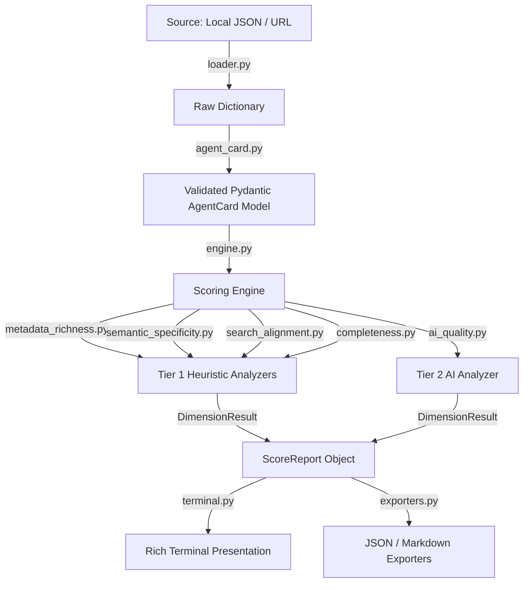
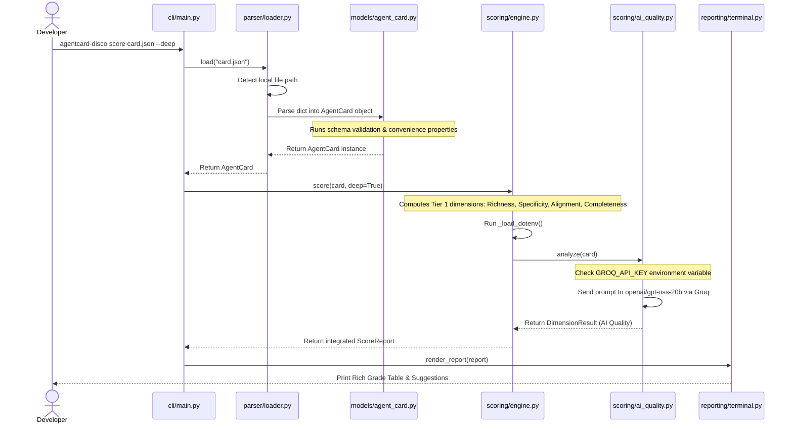

# How It Works: agentcard-disco Under the Hood

This document is a comprehensive guide to the architecture, design decisions, scoring logic, and workflows of `agentcard-disco`. It is designed for onboarding developers, preparing for technical interviews, or explaining the project to anyone interested in the technical details of the tool.

---

## 1. Project Mission & Context

### What are A2A Agent Cards?
In an **Agent-to-Agent (A2A)** ecosystem, autonomous AI agents must discover, communicate, and collaborate with one another. To do this, agents need a standardized, machine-readable way to announce who they are, what skills they possess, what data formats they accept/produce, and how they can be securely called. This is an **Agent Card**—a JSON manifest detailing an agent's metadata, capabilities, security interfaces, and skills.

### The Role of `agentcard-disco`
Just publishing an Agent Card is not enough; it needs to be *discoverable*. An agent card that uses vague language (e.g., "processes data"), generic tags, or missing documentation URLs will rank poorly or fail to be matched by automated routing orchestrators. 

`agentcard-disco` (short for *Agent Card Discoverability*) acts as a validator and optimization engine. It:
1. **Validates** card JSON files against standard schema definitions.
2. **Scores** cards out of 100 points (Tier 1) across four core discoverability dimensions.
3. **Applies optional AI-assisted scoring** (Tier 2, +20 points) for deep semantic analysis of the card.
4. **Surfaces actionable suggestions** sorted by priority to guide the developer in optimizing their card before publishing it to a registry.

---

## 2. High-Level Architecture & Separation of Concerns

The codebase is structured cleanly to enforce a strict separation of concerns, separating input ingestion, validation, scoring algorithms, and reporting formats.



### Module Breakdown
- **CLI Layer (`src/agentcard_disco/cli/`)**:
  - [`main.py`](file:///c:/Users/HP/Documents/Projects/agentcard-disco/src/agentcard_disco/cli/main.py): Orchestrates CLI commands (`auth`, `score`, `suggest`, `compare`), manages flags (`--deep`, `--format`, `--fail-under`), and decides between local Groq and remote API paths.
  - [`config.py`](file:///c:/Users/HP/Documents/Projects/agentcard-disco/src/agentcard_disco/cli/config.py): Manages local configurations and saves user API keys to `~/.agentcard-disco/config.json` with secure restricted file permissions.
- **Parser Layer (`src/agentcard_disco/parser/`)**:
  - [`loader.py`](file:///c:/Users/HP/Documents/Projects/agentcard-disco/src/agentcard_disco/parser/loader.py): Handles local and HTTP URL sources, resolving remote addresses with a standard fallback to the `/.well-known/agent-card.json` path.
- **Data Model Layer (`src/agentcard_disco/models/`)**:
  - [`agent_card.py`](file:///c:/Users/HP/Documents/Projects/agentcard-disco/src/agentcard_disco/models/agent_card.py): Defines the Pydantic models mapping out the JSON schema.
- **Scoring Layer (`src/agentcard_disco/scoring/`)**:
  - [`engine.py`](file:///c:/Users/HP/Documents/Projects/agentcard-disco/src/agentcard_disco/scoring/engine.py): Executes the scoring suite and merges results.
  - Heuristics: [`metadata_richness.py`](file:///c:/Users/HP/Documents/Projects/agentcard-disco/src/agentcard_disco/scoring/metadata_richness.py), [`semantic_specificity.py`](file:///c:/Users/HP/Documents/Projects/agentcard-disco/src/agentcard_disco/scoring/semantic_specificity.py), [`search_alignment.py`](file:///c:/Users/HP/Documents/Projects/agentcard-disco/src/agentcard_disco/scoring/search_alignment.py), [`completeness.py`](file:///c:/Users/HP/Documents/Projects/agentcard-disco/src/agentcard_disco/scoring/completeness.py).
  - AI Analyzer: [`ai_quality.py`](file:///c:/Users/HP/Documents/Projects/agentcard-disco/src/agentcard_disco/scoring/ai_quality.py).
  - Results modeling: [`result.py`](file:///c:/Users/HP/Documents/Projects/agentcard-disco/src/agentcard_disco/scoring/result.py).
- **Reporting Layer (`src/agentcard_disco/reporting/`)**:
  - [`terminal.py`](file:///c:/Users/HP/Documents/Projects/agentcard-disco/src/agentcard_disco/reporting/terminal.py): Visual terminal rendering utilizing `rich`.
  - [`exporters.py`](file:///c:/Users/HP/Documents/Projects/agentcard-disco/src/agentcard_disco/reporting/exporters.py): Exports reports to Markdown (great for PR comments) and JSON (for CI/CD pipelines).
- **Server Component (`server/`)**:
  - FastAPI hosted service providing `/v1/score`, `/v1/compare`, `/v1/suggest`, and key registration.

---

## 3. Data Validation Layer (`models/agent_card.py` & `parser/loader.py`)

A raw JSON manifest undergoes validation before scoring to guarantee structure correctness.

### Data Ingestion
[`loader.py`](file:///c:/Users/HP/Documents/Projects/agentcard-disco/src/agentcard_disco/parser/loader.py) determines if the `source` is a local file or a URL. For URLs:
1. It executes an HTTP GET request to the target URL.
2. If it encounters a 404 or connection issue, it automatically attempts a fallback path: `url.rstrip('/') + '/.well-known/agent-card.json'`.
3. If both fail, it raises a `FetchError`.

### Validation Strategy
Once raw JSON is loaded, it is passed to the Pydantic validator in [`agent_card.py`](file:///c:/Users/HP/Documents/Projects/agentcard-disco/src/agentcard_disco/models/agent_card.py). 

Design patterns implemented in the model include:
* **Forward Compatibility**: The models specify `model_config = {"extra": "allow"}`. This allows registries to extend the A2A metadata spec in the future without breaking old client versions of `agentcard-disco`.
* **Logical Constraints**: Standard Pydantic field validation is supplemented with logical rules (e.g., verifying that all `skills` declared in the card have unique `id` fields).
* **Computed Properties**: The `AgentCard` model exposes several `@property` helpers that extract characteristics used by downstream scoring dimensions:
  - `is_semver`: Verifies if the version string matches standard Semantic Versioning.
  - `has_streaming`: Evaluates if the agent declares capability to stream token outputs.
  - `all_tags`: Returns a unique set of all skill tags.

---

## 4. Scoring Engine & Dimension Details

Scoring is split into two tiers:
* **Tier 1 (Core)**: 4 deterministic heuristic analyzers. Totaling **100 points**.
* **Tier 2 (Deep)**: 1 optional AI-assisted analyzer. Adds up to **20 points** (totaling 120 points).

### 4.1 Tier 1: Core Heuristics (100 Points)

#### A. Metadata Richness (30 Points Max)
Measures the depth and detail of the card.
* **Agent Description Length (8 pts)**: Checks the character length of the top-level agent description. Full points for $\ge 100$ characters, partial credit (50%) for $\ge 40$ characters, 20% credit for $< 40$ characters, and 0 points for empty descriptions.
* **Skill Description Length (8 pts)**: Analyzes descriptions of individual skills. Scores each skill ($1.0$ for $\ge 60$ chars, $0.5$ for $\ge 20$ chars, $0.0$ otherwise) and scales the average across all skills up to 8 points.
* **Tag Coverage (6 pts)**: Checks if skills have tags. Full points when all skills have $\ge 3$ tags; partial credit for skills with 1–2 tags.
* **Examples per Skill (5 pts)**: Real-world prompt examples are crucial for orchestrators. Awarded proportionally to the fraction of skills that include at least one example utterance.
* **Enrichment Fields (3 pts)**: Rewards the developer for providing optional registry-enrichment attributes: `provider` (1 pt), `documentationUrl` (1 pt), and `iconUrl` (1 pt).

#### B. Semantic Specificity (30 Points Max)
Evaluates the clarity, verbosity, and distinctiveness of the language.
* **Filler Word Penalty (10 pts)**: Calculates the ratio of vague words (e.g., "helps", "various", "powerful", "flexible", "easy", "efficient") to total words in descriptions. A ratio $\le 8\%$ receives 10 points, scaling linearly down to 0 points when the filler ratio reaches $\ge 25\%$.
* **Skill Jaccard Similarity (10 pts)**: Detects duplicate or copy-pasted skill definitions. It tokenizes skill descriptions and computes the pairwise Jaccard Similarity:
  $$J(A, B) = \frac{|A \cap B|}{|A \cup B|}$$
  If the maximum similarity across skill pairs is $< 0.30$, full 10 points are awarded; $0.30 \le J < 0.50$ receives 5 points; $\ge 0.50$ receives 0 points. Cards with 1 skill get a default passing score of 10.
* **Action & Domain Density (10 pts)**: Measures how specific the vocabulary is. It calculates the density of action verbs (e.g., "parse", "compute", "ingest", "extract") and domain nouns (e.g., "CSV", "JSON", "pipeline", "API"). A density $\ge 12\%$ receives full points, scaling linearly down to 0 below $5\%$.

#### C. Search Alignment (20 Points Max)
Measures how easy the agent is to find in search queries.
* **Registry Query Tag Match (10 pts)**: Matches the card's tags against a curated index of standard A2A registry search terms across 8 intent clusters (8 distinct matched terms = full 10 points).
* **Name & Description Keyword Matching (6 pts)**: Looks for curated A2A search terms inside the agent name, skill names, and descriptions (6 distinct matched terms = full 6 points).
* **Input/Output MIME declarations (4 pts)**: Checks if the card explicitly declares non-generic supported format MIME types (beyond `text/plain`, e.g., `application/json`, `text/markdown`, `text/csv`) in input modes (2 pts) and output modes (2 pts).

#### D. Completeness (20 Points Max)
Measures the technical readiness of the agent interface.
* **SemVer Formatting (4 pts)**: Enforces `MAJOR.MINOR.PATCH` Semantic Versioning for `version` strings (2 pts partial credit for `MAJOR.MINOR`).
* **Declared Capabilities (6 pts)**: Scores whether the agent explicitly enables A2A capability flags: `streaming` (3 pts), `pushNotifications` (2 pts), and `stateTransitionHistory` (1 pt).
* **Transport Multi-Interface (4 pts)**: Checks if the card defines multiple protocol transport entry points (e.g., HTTP + gRPC) under `additionalInterfaces` (4 pts), or awards 1 pt if the single primary `url` uses HTTPS.
* **Security & Auth Configurations (4 pts)**: Verifies if the card declares and applies a valid security scheme (`securitySchemes` + `security` = 4 pts, explicit `public` scheme = 3 pts, `securitySchemes` without `security` = 2 pts).
* **Protocol Version (2 pts)**: Verifies that the card explicitly specifies the target A2A specification `protocolVersion`.

---

### 4.2 Tier 2: AI-Assisted Scoring (20 Points Max)

When the `--deep` flag is passed, the tool performs semantic evaluation of the descriptions and examples.

#### Dual-Execution Modes
The engine checks for keys in this order:
1. **Local Groq Mode (Direct)**: If `GROQ_API_KEY` is present in the local environment (or `.env` file), `agentcard-disco` imports the `groq` package and completes the chat completion locally. This bypasses any external service routing.
2. **Hosted API Mode (Proxied)**: If the user has set up a key via the `auth` command, the CLI sends the card payload to the hosted API server, which completes the analysis.
3. If neither is available, it warns the user and exits.

#### The "Model Observes, Python Scores" Architecture
To prevent the score variance common in LLM scoring, this tool uses a structured approach:
* **The model is never asked to output a score.**
* Instead, the system prompt directs the model to perform a categorical audit. It must return a JSON block answering exactly 5 specific questions with **"yes"**, **"no"**, or **"partial"**, along with a one-sentence reasoning block.
* Python parses this response and maps the answers to points:

| Question Audited | Point Mapping |
| :--- | :--- |
| **Q1: Description Specificity** | `yes` = 6.0 pts \| `partial` = 3.0 pts \| `no` = 0.0 pts |
| **Q2: Skill Distinctness** (auto-yes for 1 skill) | `yes` = 4.0 pts \| `partial` = 2.0 pts \| `no` = 0.0 pts |
| **Q3: Realism of Examples** (0 if no examples) | `yes` = 4.0 pts \| `partial` = 2.0 pts \| `no` = 0.0 pts |
| **Q4: Card Coherence** (name $\leftrightarrow$ skills $\leftrightarrow$ tags) | `yes` = 3.0 pts \| `partial` = 1.0 pts \| `no` = 0.0 pts |
| **Q5: Input/Output Explanations** | `yes` = 3.0 pts \| `partial` = 1.0 pts \| `no` = 0.0 pts |

This ensures that the score remains stable across runs, as the categorical evaluations map to fixed points.

#### Resiliency & Reliability
* **Timeouts**: The local Groq client is initialized with `timeout=20.0` seconds to prevent hangs. Remote API calls use a `90.0` second socket timeout to allow for server latency.
* **Error Tolerances**: If an API call fails, rate limits occur, or the model outputs invalid JSON, the exception is caught. The tool writes a warning to the console, assigns `0` points for Tier 2, and prints the Tier 1 scores rather than crashing.
* **Exponential Backoff**: Local completions retry up to 3 times, sleeping with backoffs (`1s`, `2s`), and waiting on HTTP 429 quota limits.
* **JSON Extraction**: Strips potential markdown code blocks (e.g., ` ```json ` fences) before parsing the output.

---

## 5. Hosted API Server Architecture (`server/`)

The repository contains an optional hosted FastAPI implementation under `server/`. This runs independently of the package CLI.

```
server/
├── main.py            # Fast API application initialization & middleware
├── score.py           # Endpoint routers for /score, /suggest, and /compare
├── register.py        # Free key registration endpoint
├── auth.py            # Token hashing (SHA-256), DB validation, & rate limiting
├── usage.py           # Asynchronous, fire-and-forget Supabase usage logs
└── requirements.txt   # Server deployment dependencies
```

### Security & Token Validation
* **API Key Registration**: The `/v1/register` endpoint allows users to request an API key.
* **Hashing Scheme**: The server never stores the raw API keys. Instead, it generates a key prefixed with `acd_` and stores only its **SHA-256 hash** in Supabase.
* **Verification**: When a request arrives, the `verify_api_key` dependency hashes the incoming key in the `X-API-Key` header and checks it against the database.

### Middleware & Background Operations
* **Rate Limiting**: Integrated via `slowapi` (based on `limits`). Endpoint limits are set to `30/hour` for scoring, and `20/hour` for comparison and suggestions.
* **Usage Logs**: To keep the scoring latency low, the server logs metadata (the key hash, endpoint hit, and timestamp) in a background task via FastAPI's `BackgroundTasks`, keeping it separate from the request lifecycle.

---

## 6. End-to-End Execution Flows

### Local CLI Scoring Flow



---

## 7. Packaging, Tooling, & CLI Setup

### Package Configuration (`pyproject.toml`)
* **Build System**: Built using `hatchling` (`hatchling.build` backend).
* **CLI script binding**: Exposes the command `agentcard-disco` mapping directly to the `cli` function in [`src/agentcard_disco/cli/main.py`](file:///c:/Users/HP/Documents/Projects/agentcard-disco/src/agentcard_disco/cli/main.py).
* **AI Dependencies**: Declared as an optional extra dependency block (`[project.optional-dependencies]`), allowing users to run the core tool without installing weightier libraries like `groq`.

### Essential CLI Operations
```bash
# Editable installation (syncs edits live)
pip install -e .

# Full installation with deep scoring support
pip install -e ".[deep]"

# CLI execution examples
agentcard-disco score ./tests/fixtures/good_card.json --deep
agentcard-disco suggest ./tests/fixtures/good_card.json --priority high
agentcard-disco compare ./tests/fixtures/good_card.json ./tests/fixtures/minimal_card.json
```

### Development Quality Checks
* **Unit Testing**: Tests are located in `tests/` and run via `pytest tests/ -v`. They validate URL resolution, parser exceptions, and the scoring logic.
* **Linting & Formatting**: Enforced via `ruff check src/`.
* **Type Safety**: Verified via `mypy src/`.
